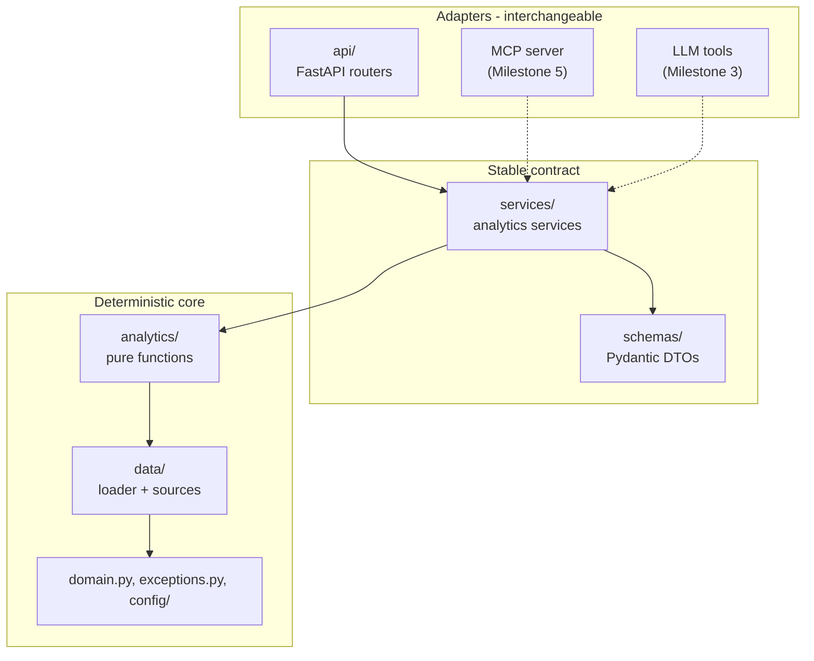
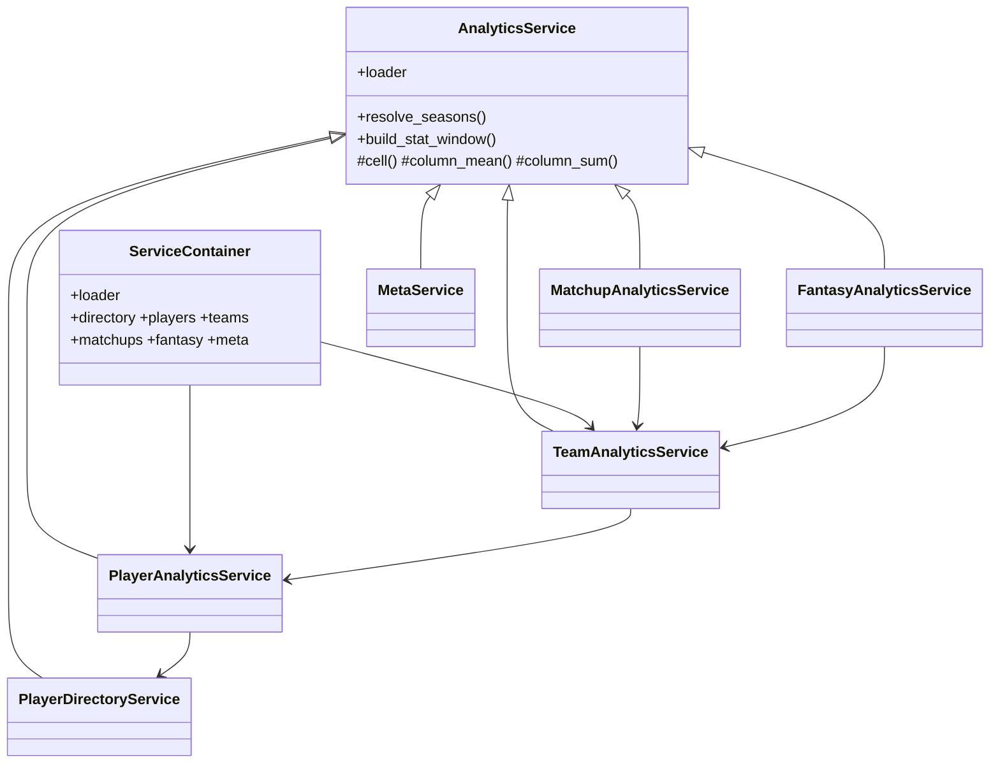

# Architecture

How the platform is layered, and why each boundary exists.

## Layers



Dependencies flow strictly downward. [tests/test_architecture.py](../tests/test_architecture.py)
asserts this mechanically, so the rule cannot quietly stop being true.

| Layer        | Responsibility                     | May import                               |
| ------------ | ---------------------------------- | ---------------------------------------- |
| `api/`       | HTTP mapping and serialisation     | `services`, `schemas`                    |
| `services/`  | Compose, validate, convert to DTOs | `analytics`, `data`, `schemas`, `domain` |
| `schemas/`   | Typed contract                     | `domain` only                            |
| `analytics/` | Deterministic computation          | `data`, `domain`                         |
| `data/`      | Load and validate nflverse data    | `domain`, `config`                       |

## The three boundaries that matter

### 1. DataFrames stop at the service layer

Polars frames are the right tool for computation and the wrong one for a
contract. They carry 150 columns, have no JSON Schema, and their column names
are upstream nflverse names that drift.

Services consume frames and emit Pydantic DTOs. Nothing above `services/`
imports Polars — asserted by a test.

This is what makes Milestones 3 and 5 cheap: `model_json_schema()` on any DTO
produces exactly the JSON Schema that LLM tool-calling and MCP tool definitions
require.

### 2. The LLM is never the source of a number

Every value the API returns is computed by a deterministic function in
`analytics/` from nflverse data. No LLM SDK is imported anywhere in `src/`, and a
test enforces that.

When the assistant arrives in Milestone 3, it will orchestrate these services and
quote their output. It will never produce a statistic itself.

### 3. Adapters are siblings, not a stack

FastAPI, the future MCP server, and the future LLM tool layer are three
**peers**, all calling `ServiceContainer` in-process. None of them calls another.

The alternative — having MCP call our own HTTP API — was rejected deliberately:

- MCP servers usually run as a stdio subprocess launched by the client. Requiring
  a separate web server to be running would make the MCP server non-functional
  standalone.
- It doubles the failure modes (timeouts, retries, connection refused) for no
  benefit on a single machine.
- The master specification lists "unnecessary microservices before the
  architecture requires them" as an explicit non-goal.

The decision is reversible. Because services return DTOs and know nothing about
their callers, adding an HTTP-backed implementation later means writing a client
class with the same method signatures. Triggers worth revisiting it: ML models
needing dedicated hardware, a non-Python consumer, or genuinely divergent
deployment boundaries.

## Object model



`AnalyticsService` is a shared implementation base, not an abstract interface.
Subclasses inherit the loader and the frame-to-DTO helpers; there is no contract
to declare abstract, so it is a plain class.

`ServiceContainer` is the composition root. One container owns one loader, and
every service shares it — which matters because the loader memoises datasets, so
five services asking for player stats trigger one download.

## Why services wrap rather than replace Milestone 1

Milestone 2 requires OOP. Milestone 2 also says _"Do not rewrite working
Milestone 1 components unless necessary."_

Both are satisfied by splitting responsibilities:

- **Milestone 1 functions** remain the numerical core — pure, deterministic, and
  covered by tests that stay meaningful.
- **Service classes** own orchestration, input validation, window resolution, and
  DTO conversion.

Porting the arithmetic into methods would have churned working code for no
behavioural gain and invalidated its tests.

## Dependency injection

```python
loader = NflDataLoader(source=ParquetDataSource("tests/fixtures/nflverse"))
container = ServiceContainer(loader=loader)
app = create_app(container=container)
```

The `DataSource` protocol introduced in Milestone 1 is what lets the entire test
suite — including every API test — run offline against committed fixtures. The
API swaps the container through `create_app`; nothing is monkeypatched.

## Request lifecycle

1. FastAPI validates path and query parameters against the typed signature.
2. A dependency resolves the service from `app.state.container`.
3. The service normalises the season/week window using `domain.py`.
4. It calls Milestone 1 analytics functions.
5. It converts the resulting frame into DTOs.
6. FastAPI serialises the DTO.
7. Any domain exception is caught by a registered handler and mapped to a status
   code — routers contain no `try`/`except`.

### Sync endpoints, deliberately

Routes are declared `def`, not `async def`. The data layer does blocking network
I/O and CPU-bound Polars work; `async def` would block the event loop and
serialise every request. Plain `def` lets Starlette run them in a threadpool.

## Caching

| Layer           | Mechanism                                            | Lifetime                      |
| --------------- | ---------------------------------------------------- | ----------------------------- |
| HTTP downloads  | `nflreadpy` filesystem cache                         | configurable TTL, default 24h |
| In-process      | `NflDataLoader` memo keyed by dataset/seasons/kwargs | process lifetime              |
| Reproducibility | `SnapshotStore` Parquet + manifest                   | until deleted                 |

One container per process means the memo stays warm across requests.

## What is deliberately absent

| Not present    | Why                                                 | Arrives in    |
| -------------- | --------------------------------------------------- | ------------- |
| LLM SDKs       | Milestone 2 must be useful without one              | 3             |
| Vector store   | No unstructured text yet                            | 4             |
| MCP server     | Needs a stable service layer first — this one       | 5             |
| ML models      | Needs a baseline and evaluation harness             | 6             |
| PostgreSQL     | Nothing yet needs transactions or concurrent writes | when required |
| Authentication | Read-only public data on localhost                  | 11            |

The absence of authentication is a decision, not an oversight: the API binds to
localhost and exposes only public data. Anything internet-facing needs it first.
