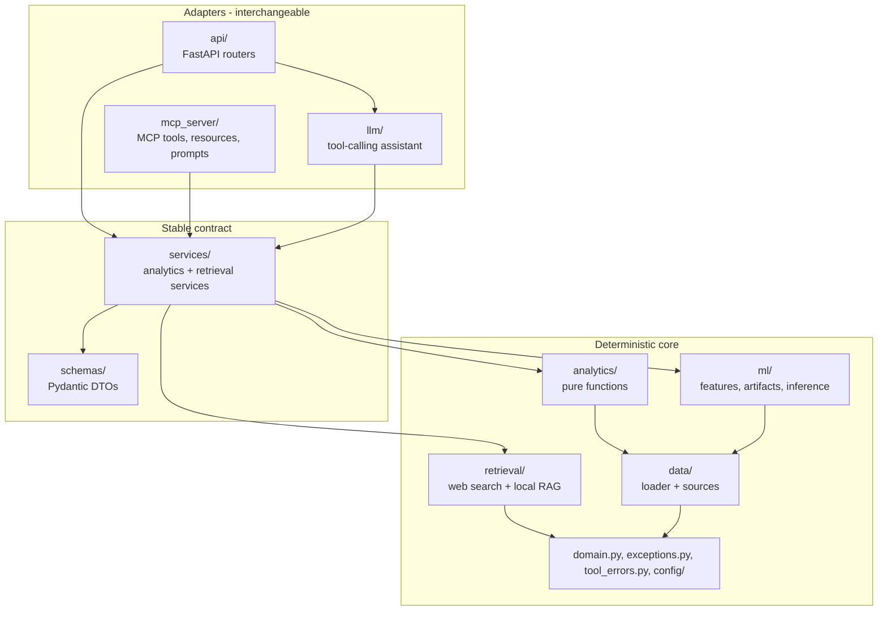
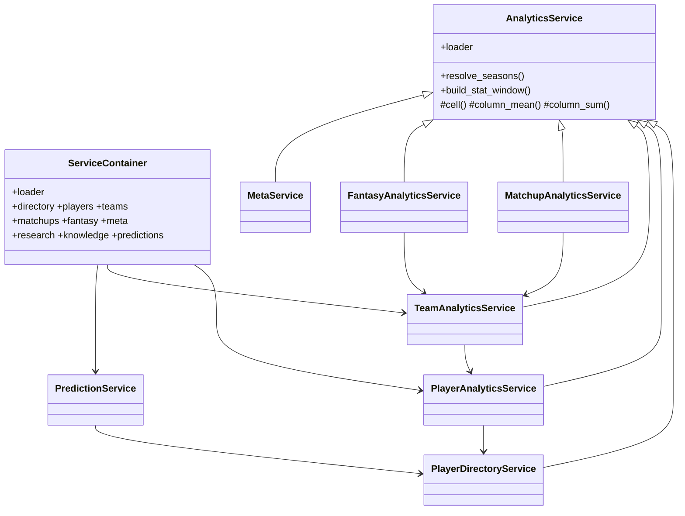

# Architecture

How the platform is layered, and why each boundary exists.

## Layers



Dependencies flow strictly downward.
[tests/architecture/test_layering.py](../tests/architecture/test_layering.py)
asserts this mechanically, so the rule cannot quietly stop being true.

| Layer         | Responsibility                     | May import                                                  |
| ------------- | ---------------------------------- | ----------------------------------------------------------- |
| `api/`        | HTTP mapping and serialisation     | `services`, `schemas`, `llm`                                |
| `mcp_server/` | MCP mapping and serialisation      | `services`, `schemas`, `domain`                             |
| `llm/`        | Tool selection and synthesis       | `services`, `schemas`, `domain`                             |
| `services/`   | Compose, validate, convert to DTOs | `analytics`, `retrieval`, `ml`, `data`, `schemas`, `domain` |
| `schemas/`    | Typed contract                     | `domain` only                                               |
| `analytics/`  | Deterministic computation          | `data`, `domain`                                            |
| `retrieval/`  | Web search and local RAG           | `schemas`, `domain`, `config`                               |
| `ml/`         | Features, model artifacts, scoring | `analytics`, `data`, `schemas`, `domain`, `config`          |
| `data/`       | Load and validate nflverse data    | `domain`, `config`                                          |

`retrieval/` and `ml/` are peers of `analytics/`, not parts of `llm/`. All three
are capabilities the service layer composes, and none knows a model exists --
which is what keeps the tool layer free of storage concerns and keeps retrieval
and prediction usable without an LLM. See [rag-design.md](rag-design.md) and
[ml-predictions.md](ml-predictions.md).

`ml/` has a second boundary inside it that matters as much as the layer rule:
**training cannot be reached from serving.** No module under `services/`, `api/`,
`llm/`, `mcp_server/`, `ml/predict/` or `ml/registry/` may import
`ml.training`, `ml.evaluation`, `ml.datasets` or `ml.cli`, so an API process can
load and score an artifact but has no code path that fits one. `ml/features/` is
deliberately on both sides: sharing one feature builder between training and
inference is the only reliable defence against train/serve skew.

`api/ -> llm/` is allowed; `llm/ -> api/` is not. The assistant is reachable
_through_ HTTP but does not depend on HTTP, so the CLI and the benchmark script
use it without a web server.

`mcp_server/` imports neither sibling, and neither imports it. What the LLM and
MCP adapters genuinely share -- argument descriptions and the error taxonomy --
lives in [`schemas/fields.py`](../src/nfl_platform/schemas/fields.py) and
[`tool_errors.py`](../src/nfl_platform/tool_errors.py), which belong to neither.
See [mcp-design.md](mcp-design.md).

## The three boundaries that matter

### 1. DataFrames stop at the service layer

Polars frames are the right tool for computation and the wrong one for a
contract. They carry 150 columns, have no JSON Schema, and their column names
are upstream nflverse names that drift.

Services consume frames and emit Pydantic DTOs. Nothing above `services/`
imports Polars — asserted by a test.

This is what makes Milestones 3 and 5 cheap: `model_json_schema()` on any DTO
produces exactly the JSON Schema that LLM tool-calling and MCP tool definitions
require. The MCP adapter goes further and returns the DTOs themselves, so each
tool publishes an `output_schema` a client can rely on before it calls.

### 2. The LLM is never the source of a number

Every value the API returns is computed by a deterministic function in
`analytics/` from nflverse data, or by a fitted model artifact in `ml/`.

Milestone 3 added an assistant without weakening that. The model orchestrates
services and quotes their output; it never produces a statistic itself. The
enforcement is structural rather than aspirational:

- `openai` may be imported **only** in `llm/providers/`, asserted by a test.
- `llm/` may not import `analytics/`, `data/`, `retrieval/` or `ml/`, so a tool
  cannot compute, retrieve or predict on its own.
- `ml/` may not import `openai` or `llm/`, so the prediction layer contains no
  language model. Also asserted by a test.
- No calculator or code-execution tool exists, so there is no numeric ability to
  reach for.
- Every number in an answer is matched against the tool results that produced
  it; misses are recorded on the run trace.

Milestone 6 extends this rather than relaxing it. A win probability is still not
something the assistant may produce: it comes from a versioned artifact, travels
with the `model_info` that identifies it, and is tagged `SourceKind.MODEL` so it
stays distinguishable from a measured statistic all the way to the answer.

See [llm-tools.md](llm-tools.md) and [ml-predictions.md](ml-predictions.md) for
the full boundary.

### 3. Adapters are siblings, not a stack

FastAPI, the assistant, and the MCP server are **peers**, all calling
`ServiceContainer` in-process. The HTTP layer exposes the assistant, but the
assistant never calls HTTP, and neither calls MCP.

The alternative — having MCP or the assistant call our own HTTP API — was
rejected deliberately:

- MCP servers usually run as a stdio subprocess launched by the client. Requiring
  a separate web server to be running would make the MCP server non-functional
  standalone.
- It doubles the failure modes (timeouts, retries, connection refused) for no
  benefit on a single machine.
- The master specification lists "unnecessary microservices before the
  architecture requires them" as an explicit non-goal.

The decision is reversible. Because services return DTOs and know nothing about
their callers, adding an HTTP-backed implementation later means writing a client
class with the same method signatures. Triggers worth revisiting it: ML models
needing dedicated hardware, a non-Python consumer, or genuinely divergent
deployment boundaries.

## Object model



`AnalyticsService` is a shared implementation base, not an abstract interface.
Subclasses inherit the loader and the frame-to-DTO helpers; there is no contract
to declare abstract, so it is a plain class.

`PredictionService` deliberately does **not** extend it. It shares none of the
season-window plumbing, and inheriting would imply it is another view over
measured data when its whole purpose is to be a different kind of claim.

`ServiceContainer` is the composition root. One container owns one loader, and
every service shares it — which matters because the loader memoises datasets, so
five services asking for player stats trigger one download.

## Why services wrap rather than replace Milestone 1

Milestone 2 requires OOP. Milestone 2 also says _"Do not rewrite working
Milestone 1 components unless necessary."_

Both are satisfied by splitting responsibilities:

- **Milestone 1 functions** remain the numerical core — pure, deterministic, and
  covered by tests that stay meaningful.
- **Service classes** own orchestration, input validation, window resolution, and
  DTO conversion.

Porting the arithmetic into methods would have churned working code for no
behavioural gain and invalidated its tests.

## Dependency injection

```python
loader = NflDataLoader(source=ParquetDataSource("tests/fixtures/nflverse"))
container = ServiceContainer(loader=loader)
app = create_app(container=container)
```

The `DataSource` protocol introduced in Milestone 1 is what lets the entire test
suite — including every API test — run offline against committed fixtures. The
API swaps the container through `create_app`; nothing is monkeypatched.

## Request lifecycle

1. FastAPI validates path and query parameters against the typed signature.
2. A dependency resolves the service from `app.state.container`.
3. The service normalises the season/week window using `domain.py`.
4. It calls Milestone 1 analytics functions.
5. It converts the resulting frame into DTOs.
6. FastAPI serialises the DTO.
7. Any domain exception is caught by a registered handler and mapped to a status
   code — routers contain no `try`/`except`.

### Sync endpoints, deliberately

Routes are declared `def`, not `async def`. The data layer does blocking network
I/O and CPU-bound Polars work; `async def` would block the event loop and
serialise every request. Plain `def` lets Starlette run them in a threadpool.

## Caching

| Layer           | Mechanism                                            | Lifetime                      |
| --------------- | ---------------------------------------------------- | ----------------------------- |
| HTTP downloads  | `nflreadpy` filesystem cache                         | configurable TTL, default 24h |
| In-process      | `NflDataLoader` memo keyed by dataset/seasons/kwargs | process lifetime              |
| Web search      | bounded in-process TTL cache, never written to disk  | 15 minutes, default           |
| Knowledge index | Parquet file loaded once per process                 | until rebuilt                 |
| Model artifacts | loaded once per process, keyed by (problem, version) | until the registry is cleared |
| Reproducibility | `SnapshotStore` Parquet + manifest                   | until deleted                 |

Web results are deliberately not persisted: the cache is in-process and bounded,
so no more third-party content is stored than a request requires.

One container per process means the memo stays warm across requests.

## What is deliberately absent

| Not present                | Why                                                            | Arrives in    |
| -------------------------- | -------------------------------------------------------------- | ------------- |
| Hosted vector database     | 97 chunks scan exactly in under a millisecond; see rag-design  | if measured   |
| Reranker / query rewriter  | Retrieval hit@1 is already 1.00; nothing left to improve       | if measured   |
| `fetch_url` tool           | Removes SSRF and the inject-a-link escalation path entirely    | if justified  |
| MCP over HTTP              | stdio needs no port or auth; HTTP needs both to be worth it    | if justified  |
| Deep-learning model        | GBDTs and linear models beat it at this row count; see ml docs | if measured   |
| Fantasy availability model | Projections are conditional on playing and say so              | if justified  |
| Agent framework            | One loop with no branching does not need one                   | 7             |
| PostgreSQL                 | Nothing yet needs transactions or concurrent writes            | when required |
| Authentication             | Read-only public data on localhost                             | 11            |

The absence of authentication is a decision, not an oversight: the API binds to
localhost and exposes only public data. Anything internet-facing needs it first.
That now includes the assistant endpoint, which spends money per request. The
MCP server sidesteps the question entirely by speaking stdio, where the trust
boundary is the local user who launched the process.
