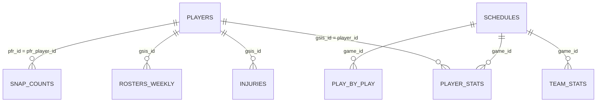

# Data Model

How nflverse data is represented inside this project, which identifiers link the
tables, and where the sharp edges are.

## Design principle

This layer is the project's **source of numerical truth**. Later milestones add
an LLM on top, but no LLM is permitted to produce a statistic. Everything here is
deterministic: the same inputs always yield the same frame.

All frames are Polars `DataFrame`s. `nflreadpy` returns Polars natively, so there
is no pandas conversion anywhere in the pipeline.

## Entities and grain

Grain is the single most important property of each table — it determines
whether an aggregation is correct or double-counts.

| Dataset          | Grain                                | Primary key (logical)                           |
| ---------------- | ------------------------------------ | ----------------------------------------------- |
| `schedules`      | one row per game                     | `game_id`                                       |
| `player_stats`   | one row per player per game          | `player_id` + `season` + `week` + `season_type` |
| `team_stats`     | one row per team per game            | `team` + `season` + `week` + `season_type`      |
| `play_by_play`   | one row per play                     | `game_id` + `play_id`                           |
| `rosters_weekly` | one row per player per team per week | `gsis_id` + `season` + `week`                   |
| `players`        | one row per player                   | `gsis_id`                                       |
| `injuries`       | one row per player per team per week | `gsis_id` + `season` + `week`                   |
| `snap_counts`    | one row per player per game          | `pfr_player_id` + `game_id`                     |
| `ff_opportunity` | one row per player per game          | `player_id` + `season` + `week`                 |

## Identifiers

There is no single universal player id in the nflverse ecosystem. This is the
most common source of silent bugs, so it is handled explicitly.

| Identifier                                  | Format           | Appears in                                                                                |
| ------------------------------------------- | ---------------- | ----------------------------------------------------------------------------------------- |
| `gsis_id` / `player_id`                     | `00-0033873`     | `players.gsis_id`, `player_stats.player_id`, `injuries.gsis_id`, `rosters_weekly.gsis_id` |
| `pfr_id` / `pfr_player_id`                  | `MahoPa00`       | `players.pfr_id`, `snap_counts.pfr_player_id`                                             |
| `esb_id`, `espn_id`, `pff_id`, `sleeper_id` | varies           | `players`, `rosters_weekly`                                                               |
| `game_id`                                   | `2024_01_BAL_KC` | `schedules`, `player_stats`, `play_by_play`, `snap_counts`                                |
| team abbreviation                           | `KC`, `BUF`      | every team-scoped dataset                                                                 |

**The GSIS id is this project's canonical player key.** Public analytics
functions accept a GSIS id.

`snap_counts` is the notable exception: it is keyed by PFR id and carries no GSIS
id. `players` is therefore the crosswalk, used by
`nfl_platform.analytics.resolve_pfr_id`. When a player has no `pfr_id`, snap
columns are **omitted** from the result rather than filled with a guess.

## Team abbreviations

nflverse stores the abbreviation that was **correct for that season**. The 2019
Raiders are `OAK`; the 2021 Raiders are `LV`.

`normalize_team` therefore only trims and uppercases. It deliberately does **not**
remap relocations, because rewriting `OAK` to `LV` would corrupt historical
queries. Validity is checked against the abbreviations actually present in the
loaded data, so no hard-coded team list can drift out of date.

## Perspective: offense vs. defense

`team_stats` contains one row per team per game describing what **that team's
offense** did. There is no separate defensive table.

A team's defense is derived from the opponent's row: the row where
`opponent_team == 'KC'` describes what an offense produced _against_ Kansas City,
which is by definition what Kansas City's defense allowed.

`get_team_defense` returns those rows with every statistic prefixed `allowed_`,
and renames the columns so `team` is always the defense and `offense_team` is the
opponent. The prefix exists so a caller can never mistake "what KC allowed" for
"what KC gained" — an error that would be invisible in an LLM-generated answer.

## Season and week semantics

- A season is labelled by the year it **starts**. The February 2025 Super Bowl
  belongs to season 2024.
- `season_type` in stats tables is `REG` or `POST`. `game_type` in `schedules` is
  finer-grained: `REG`, `WC`, `DIV`, `CON`, `SB`.
- Regular-season weeks run 1–18 from 2021 onward and 1–17 before that.
  Postseason weeks continue from 19 to 22. Validation accepts 1–22.
- `EARLIEST_SEASON` is 1999, the first season nflverse publishes.

### "Last N games" rather than "last N weeks"

Analytics functions take `last_n_games`, not `weeks`. A bye week, an inactive
week, or a mid-season trade means the last 4 _weeks_ may contain fewer than 4
games. Counting games keeps sample sizes honest, which matters once these numbers
feed predictions.

An explicit `weeks=` filter is still available when a caller genuinely wants
specific week numbers.

### Game-type default

`season_type` defaults to `None` on every analytics function, meaning **all game
types are included**. Defaulting to `"REG"` would make "the last 4 games" quietly
stop at week 18 and exclude a team's most recent — and most relevant — playoff
games. Callers who want regular-season-only pass `season_type="REG"`.

## Dtype normalisation

nflverse is not internally consistent. `ff_opportunity` ships `season` as a
**string** and `week` as a **float**, while every other dataset uses `Int32`.

`normalize_key_columns` coerces `season` and `week` to `Int32` on every load, so
joins and filters behave uniformly. The cast is non-strict: an unparseable value
becomes null rather than aborting an entire load.

## Schema contracts

Each dataset declares `required_columns` in the registry at
[src/nfl_platform/data/ingestion/datasets.py](../src/nfl_platform/data/ingestion/datasets.py).

This is deliberately a **minimal** subset — only the columns this project reads.
Validating the full upstream schema would make the project fail whenever nflverse
adds a harmless new column. Extra columns pass through untouched; missing ones
raise `SchemaValidationError` naming the dataset and the absent columns.

The `integration`-marked tests verify these contracts against live nflverse data,
which is how upstream schema drift gets caught.

## Missing data

| Situation                           | Behaviour                                      | Rationale                                     |
| ----------------------------------- | ---------------------------------------------- | --------------------------------------------- |
| Unknown player id in `player_stats` | raises `PlayerNotFoundError`                   | a typo'd id is a caller mistake               |
| Player with no injury rows          | returns an empty frame                         | a healthy player legitimately has no report   |
| Unknown team abbreviation           | raises `TeamNotFoundError` listing valid teams | a typo'd team is a caller mistake             |
| Valid season with no rows           | returns an empty frame with schema intact      | the season may simply not be published yet    |
| Future/unplayed games               | excluded by `completed_only=True`              | null scores would corrupt aggregates          |
| Null statistic                      | ignored by `mean`, treated as 0 by `sum`       | Polars default; documented rather than masked |

Empty results always preserve the frame's schema, so downstream code can select
columns without branching on emptiness.

## Caching and reproducibility

Two independent layers:

1. **Download cache** — delegated to `nflreadpy`'s filesystem cache with a
   configurable TTL. Not reimplemented here.
2. **In-process memoisation** — `NflDataLoader` memoises by
   `(dataset, seasons, kwargs)` so one analytics call chain downloads a dataset
   once. Clear it with `loader.clear_cache()`.

For genuine reproducibility, `SnapshotStore` writes Parquet snapshots plus a JSON
manifest recording row count, column count, seasons, and capture timestamp. This
matters because **nflverse data is mutable**: stat corrections silently change
historical rows. A snapshot directory can be replayed through
`ParquetDataSource`, so an analysis can be re-run against exactly the data it
originally saw.

## Known limitations

- `snap_counts` has no GSIS id and depends on the `players` crosswalk.
- `ff_opportunity` is modelled data, not observed fact, and lags the other feeds.
- `play_by_play` has 372 columns; always pass a column projection.
- Injury reports reflect what teams _published_, which is a strategic document,
  not a medical record.
- Betting lines in `schedules` are closing lines from one aggregator.
- Nothing here is a database yet. PostgreSQL arrives when the API milestone needs
  it, not before.
