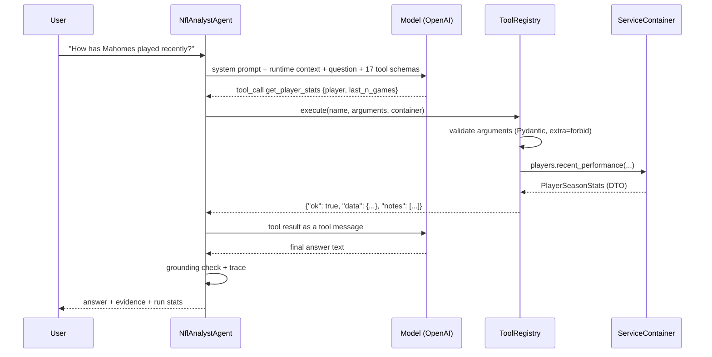

# LLM Tool Calling

How the assistant works, and exactly where the boundary between the language
model and the deterministic analytics layer sits.

## The boundary in one sentence

The model chooses **which** questions to ask of the analytics layer and **how**
to phrase the answer; the analytics layer decides **what the numbers are**.



Nothing in `llm/` computes a statistic. Every tool is an argument model, a
description, and one call into a Milestone 2 service. An architecture test
asserts that `llm/` never imports `analytics/` or `data/`, so a tool cannot
quietly start doing arithmetic of its own.

## Why in-process and not over HTTP

The agent holds a `ServiceContainer` and calls it directly. FastAPI and the
assistant are **siblings**, both adapters over the same services — see
[architecture.md](architecture.md). Routing tool calls through our own HTTP API
would double the failure modes for no benefit on one machine.

## Package layout

| Module                           | Responsibility                                                               |
| -------------------------------- | ---------------------------------------------------------------------------- |
| `llm/agent.py`                   | The bounded tool-calling loop                                                |
| `llm/client.py`                  | Provider-agnostic message types, `ChatClient` protocol, `ScriptedChatClient` |
| `llm/providers/openai_client.py` | The **only** module that imports `openai`                                    |
| `llm/registry.py`                | Registration, schema export, validation, dispatch                            |
| `llm/tools/`                     | One thin class per capability                                                |
| `llm/results.py`                 | Tool result envelope, truncation, null suppression                           |
| `llm/errors.py`                  | Domain exception → model-readable error payload                              |
| `llm/grounding.py`               | Numeric grounding detector                                                   |
| `llm/trace.py`                   | Latency, tokens, estimated cost, executed calls                              |
| `llm/prompts/`                   | Versioned system prompts                                                     |
| `llm/factory.py`                 | Construction used by the API, the CLI and the benchmark                      |
| `llm/cli.py`                     | Interactive command line                                                     |

## Tools

Seventeen tools, each mapping 1:1 to a service method. The menu is kept small on
purpose: tool-selection accuracy degrades as it grows.

### Resolution

| Tool                 | Service             | Notes                                     |
| -------------------- | ------------------- | ----------------------------------------- |
| `search_players`     | `directory.search`  | The recovery path from `ambiguous_player` |
| `get_player_profile` | `directory.profile` | Biography and career; no statistics       |

### Player

| Tool                  | Service                                                                |
| --------------------- | ---------------------------------------------------------------------- |
| `get_player_stats`    | `players.recent_performance` / `players.season_performance` (`window`) |
| `get_player_game_log` | `players.game_log`                                                     |
| `get_player_usage`    | `players.usage`                                                        |
| `get_player_injuries` | `players.injury_report`                                                |
| `compare_players`     | `players.compare`                                                      |

### Team and matchup

| Tool                | Service                                                  |
| ------------------- | -------------------------------------------------------- |
| `get_team_stats`    | `teams.offense` / `teams.defense` (`side`)               |
| `get_team_form`     | `teams.recent_form` / `teams.home_away_splits` (`split`) |
| `get_recent_games`  | `teams.game_log`                                         |
| `get_team_injuries` | `teams.injury_report`                                    |
| `get_matchup`       | `matchups.analyze`                                       |

### Fantasy

| Tool                          | Service                   |
| ----------------------------- | ------------------------- |
| `get_fantasy_production`      | `fantasy.production`      |
| `get_fantasy_usage_trend`     | `fantasy.usage_trend`     |
| `get_fantasy_matchup_context` | `fantasy.matchup_context` |
| `compare_fantasy_players`     | `fantasy.compare`         |

### Reference

| Tool                  | Service                                               |
| --------------------- | ----------------------------------------------------- |
| `list_reference_data` | `meta.teams` / `meta.seasons` / `meta.current_season` |

`GET /api/v1/assistant/tools` returns this catalogue with each tool's live JSON
Schema.

Pairs such as offence/defence and recent/season are merged behind an enum
argument rather than split into separate tools — one tool with a clear choice is
easier for a model to select correctly than two near-identical names.

## Argument validation

Three rings, and only the first is new in this milestone:

1. **Schema.** `model_json_schema()` on the tool's Pydantic model is sent to the
   provider, so most malformed calls never happen.
2. **Structural.** `model_validate()` with `extra="forbid"`, plus `ge`/`le` and
   `min_length` constraints. A hallucinated argument name is rejected loudly.
3. **Semantic.** `domain.py` and the services: season 1850, week 99, team `XYZ`,
   an unknown or ambiguous player.

Schemas are generated, never hand-written, so the schema the model sees and the
validation that runs cannot drift apart.

## Tool results

```json
{ "tool": "get_player_stats", "ok": true,
  "data": { "player": {...}, "window": {...}, "totals": {...} },
  "notes": ["'entries' shows the first 10 of 32 entries; totals and averages still cover the full window."] }
```

Two policies matter:

- **Nulls are dropped.** A receiver has no `completions`. Omitting the field
  saves tokens and stops the model reading `null` as `zero`.
- **Lists are capped at 10 and the cap is announced.** A model shown 10 of 32
  entries will otherwise describe them as the whole window. `list_reference_data`
  is exempt: a partial list of valid teams would read as the only valid teams.

## Errors

A tool failure is a message to the model, not an exception to the user. Only the
provider being unreachable ends a run.

```json
{
  "tool": "get_player_stats",
  "ok": false,
  "error": {
    "code": "ambiguous_player",
    "message": "...",
    "retryable": true,
    "recovery": "Several players share this name. Pick the player_id from candidates...",
    "context": {
      "candidates": [
        { "player_id": "00-0033280", "description": "WR, LAC, 2017-2024" }
      ],
      "total_candidates": 9
    }
  }
}
```

| Situation                     | Code                                 | Behaviour                                              |
| ----------------------------- | ------------------------------------ | ------------------------------------------------------ |
| Unknown tool name             | `unknown_tool`                       | Valid names returned                                   |
| Bad JSON                      | `malformed_arguments`                | Model re-sends                                         |
| Bad/extra/missing arguments   | `invalid_arguments`                  | Field-level problems **plus the real schema**          |
| Ambiguous name                | `ambiguous_player`                   | Candidates returned; model chooses or asks             |
| Unknown player / team         | `player_not_found`, `team_not_found` | Valid teams listed; no substitution allowed            |
| Invalid season / week / count | `invalid_season`, …                  | Valid range returned                                   |
| Upstream outage               | `data_source_unavailable`            | `retryable: false`; recovery forbids estimating        |
| Unexpected exception          | `tool_error`                         | Logged with traceback; **no internals in the payload** |

Every error carries a `recovery` hint. That field is what turns "this name is
ambiguous" from a dead end into a correct second call.

A tool that fails twice is withdrawn from the schema list for the rest of the
run, so a model that cannot satisfy a schema does not burn the whole budget.

That withdrawal rule makes **aggregate error reporting essential**. A comparison
of six quarterbacks that reported only the first ambiguous name would fail on
"Josh Allen", get corrected, then fail on "Lamar Jackson" — two failures, tool
withdrawn, comparison lost for the run. Batch resolution therefore reports every
unidentifiable name at once under `unresolved_players`, so a single retry fixes
the whole call:

```json
{
  "code": "unresolved_players",
  "context": {
    "ambiguous": [
      {
        "query": "Josh Allen",
        "candidates": [
          { "player_id": "00-0034857", "description": "QB, BUF, 2018-2026" },
          { "player_id": "00-0030833", "description": "C, TB, 2014-2016" }
        ]
      },
      { "query": "Lamar Jackson", "candidates": ["..."] }
    ],
    "not_found": []
  }
}
```

The same principle as `invalid_arguments`, which reports every bad field rather
than the first. One failure, one correction, one success.

**An empty result is not an error.** A player with no injury entries returns
`ok: true` with an empty list. That is a fact about the player.

## Preventing invented statistics

Defence in depth, because prompting alone is not a control.

1. **No numeric ability is offered.** No calculator, no code execution. Every
   number the model can state must have arrived from a tool.
2. **The prompt forbids it explicitly** — no remembered numbers, no estimates,
   no arithmetic over tool output. Deriving a value is banned precisely so that
   every stated number is traceable to one field.
3. **Reference data is a tool**, so the model can check a team abbreviation or
   the current season instead of assuming.
4. **Truncation is announced**, so a subset is never mistaken for the whole.
5. **Grounding check.** Every number in the answer is matched against the
   numbers in the tool results, allowing for rounding and for 0–1 shares spoken
   as percentages. Unmatched numbers land on `trace.ungrounded_numbers` and are
   returned in the API response.
6. **Evidence is trace-derived.** The `evidence` list is built from the calls
   that actually executed, so a model cannot cite a tool it never called.

### Why grounding reports rather than blocks

Regenerating on a finding costs a second full run for a signal that is
occasionally a false positive. At runtime the finding is attached to the trace
and logged; in the test suite a finding is a failure. Formal gating belongs to
the Milestone 8 evaluation harness.

## Budgets

| Setting                   | Default | Purpose                        |
| ------------------------- | ------- | ------------------------------ |
| `NFL_LLM_MAX_ITERATIONS`  | 5       | Model round-trips per question |
| `NFL_LLM_MAX_TOOL_CALLS`  | 12      | Tool executions per question   |
| `NFL_LLM_TIMEOUT_SECONDS` | 60      | Per provider request           |

On exhaustion the agent makes one final call **with no tools offered**, which
forces a real answer stating what could not be retrieved. `trace.stop_reason`
records which budget was hit.

## Prompts

Prompts are files, so a change to the model's instructions is a reviewable diff.
The version (`analyst_v1`) is recorded in every trace and returned in the API
response. Tests assert that the grounding rules are present, so deleting them
breaks the build rather than silently changing behaviour.

`orchestrator_v1` is deliberately absent: there is nothing to orchestrate until
Milestone 7.

## Cost and latency

`RunTrace` records iterations, tool calls with durations, prompt/completion
tokens, wall time, and an estimated cost from a per-model price table in
`llm/trace.py`. Prices drift; the table is for reporting, not billing.

```powershell
python scripts/llm_benchmark.py --output docs/llm-evaluation.json
```

runs a fixed 12-question set against the committed fixtures and reports
tool-selection accuracy, grounding rate, latency, tokens and cost. Fixtures
rather than live nflverse means the model is the only moving part.

### Model selection

`gpt-4-turbo` was the original choice and has since been retired from new
accounts. Candidates were probed for tool-calling correctness and adapter
compatibility:

| Model                   | Tool call | Latency | Notes                            |
| ----------------------- | --------- | ------- | -------------------------------- |
| `gpt-4.1`               | correct   | 2.4 s   | **chosen**                       |
| `gpt-4.1-mini`          | correct   | 0.8 s   | ~5x cheaper, the cost lever      |
| `gpt-4o`                | correct   | 1.4 s   | works, pricier and slower        |
| `gpt-4o-mini`           | correct   | 1.3 s   | works                            |
| `o4-mini`, `gpt-5-mini` | —         | —       | reject an explicit `temperature` |

Reasoning models refuse any `temperature` value, so `NFL_LLM_TEMPERATURE` may be
left blank to omit the parameter entirely.

### Measured results — `gpt-4.1`, `analyst_v1`, 12 questions

| Metric                  | Value                        |
| ----------------------- | ---------------------------- |
| Tool-selection accuracy | 1.00                         |
| Grounding rate          | 1.00                         |
| Mean latency            | 9.8 s                        |
| Median latency          | 10.2 s                       |
| Total tokens            | 135,559                      |
| Total cost              | $0.28 (~$0.024 per question) |
| Errors                  | 0                            |

Token use is dominated by the tool schemas, which are resent on every turn —
roughly 9k tokens before the question is even considered. That is the price of
giving the model a 17-tool menu, and the obvious lever if cost becomes a
constraint.

### What the first benchmark run caught

Grounding started at 0.75. All three findings were worth having.

**A missing DTO field, not a disobedient model.** On the start/sit question the
model reported "1.5 passing touchdowns per game". `TeamDefenseSummary` exposed
`total_allowed_passing_tds: 6` over a 4-game window with no per-game
counterpart, so the model divided 6 by 4 itself.

The fix was to publish the average rather than to police the division —
`avg_allowed_passing_tds` and `avg_allowed_rushing_tds` now come straight from
`summarize_team_stats`, which had been computing them all along. A test asserts
that **every** `total_allowed_*` field has an `avg_allowed_*` counterpart, so the
gap cannot reopen.

The general lesson: a total published without its average is an invitation to
derive. Where a caller can reasonably want a per-game figure, the DTO should
supply it.

Closing the defensive gap surfaced the same shape on offence, and then once
more: asked for "touchdowns per game", the model added `avg_passing_tds` and
`avg_rushing_tds` together. `avg_total_yards` already existed for exactly that
reason, so `avg_total_tds` and `avg_allowed_total_tds` now mirror it. Both team
summaries expose a per-game counterpart for every total, and a parametrised test
asserts it for each.

The line is combinations a caller would naturally ask for — total yards, total
touchdowns. Genuinely novel analysis is still the model's own reasoning, must be
presented as such, and will still be flagged by the detector. That is the
intended behaviour, not a gap to chase.

**Two false positives in the detector**, both fixed:

- **Rounding ties.** The tool returned `129.25`; the model correctly said
  `129.3`. Python's `round(129.25, 1)` is `129.2`, because it rounds ties to
  even. Comparison is now "within half a unit of the last stated decimal place",
  which accepts either convention.
- **Numbers from the question.** Echoing "2024" back from the user's own
  question was flagged when no tool had run. Question numbers now count as
  available.

## Testing

| Tier              | Command         | What it covers                                                                                   |
| ----------------- | --------------- | ------------------------------------------------------------------------------------------------ |
| Offline (default) | `pytest`        | Scripted model, **real** tools and fixtures: selection, validation, recovery, grounding, budgets |
| Live              | `pytest -m llm` | A real model: does it actually call tools, is the answer grounded, is an unknown player refused  |

The offline tier fakes only the model. Tools execute against real fixture data,
so the tests exercise genuine validation and error mapping rather than mocks of
them.

## Adding a tool

1. Add a `ToolArgs` subclass and a `Tool` subclass in `llm/tools/`.
2. Register it in `DEFAULT_TOOL_TYPES`.
3. Add a representative call to `TOOL_CALLS` in `tests/llm/test_tools.py` — a
   test asserts every registered tool appears there, so a new tool cannot ship
   untested.

If a tool needs a branch that changes a number, that logic belongs in
`services/`, not here.
