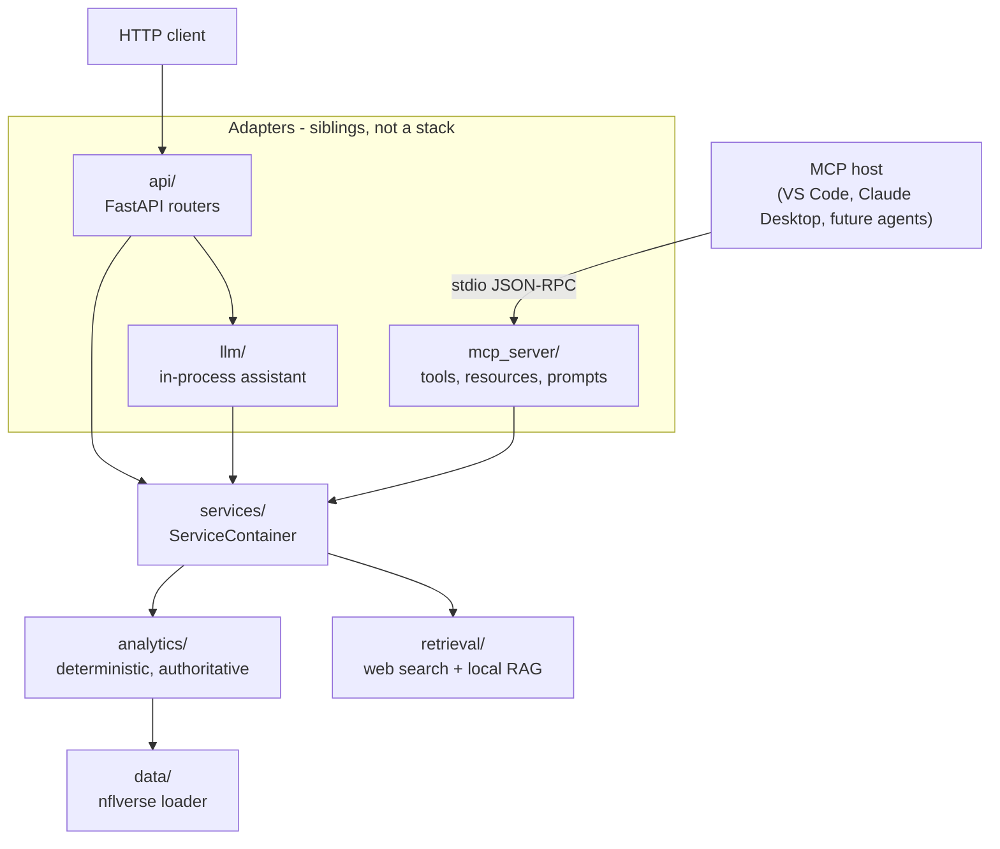

# MCP Design

How this project exposes its NFL capabilities over the Model Context Protocol,
and why the boundary sits where it does.

## What MCP is

The [Model Context Protocol](https://modelcontextprotocol.io) is a JSON-RPC
protocol that lets an AI application (the _host_ — Claude Desktop, VS Code, an
agent framework) discover and use capabilities provided by a separate program
(the _server_). A server offers three kinds of thing:

| Primitive     | Controlled by   | Used for                                |
| ------------- | --------------- | --------------------------------------- |
| **Tools**     | the model       | actions the model decides to take       |
| **Resources** | the application | data the application loads into context |
| **Prompts**   | the user        | templates a person picks from a menu    |

The value is that the contract is standard. Any host that speaks MCP can use
this server without knowing it is Python, without importing `nfl_platform`, and
without anyone writing an integration for that specific host.

## Why it is useful here

Milestones 1–6 produced something worth exposing: a deterministic NFL analytics
layer, a bounded web-search channel, a curated local knowledge base, and two
trained prediction models, all
behind one typed service contract. Until Milestone 5 the only ways to reach it
were an HTTP API (for code) and an in-process assistant (for this project's own
model).

MCP adds the third audience: **AI hosts that are not ours.** The same guarantee
the assistant gets — that a yardage figure is computed from nflverse rather than
recalled by a model — now travels to any MCP client, with the evidence policy
stated in the server's `instructions` and repeated in every tool description.

## Why MCP is used at this boundary

MCP sits exactly where the REST API sits: above `services/`, below nothing.



Three properties follow from that placement, and all three are asserted by
[tests/architecture/test_layering.py](../tests/architecture/test_layering.py):

1. **MCP contains no business logic.** Every tool body validates through its
   schema, calls one service method, and returns the DTO it receives.
   `mcp_server/` may not import `analytics/`, `data/` or `retrieval/`.
2. **MCP is not a layer above the other adapters.** `mcp_server/` may not import
   `api/` or `llm/`, and `llm/` may not import `mcp_server/`. The assistant still
   calls services in-process; routing it through MCP would add a process hop, a
   serialisation step and a second failure mode for no gain.
3. **The MCP SDK is quarantined.** Only `mcp_server/` may import `mcp`, the same
   rule that keeps `openai` inside `llm/providers/` and `httpx` inside the two
   search adapters. "What depends on the protocol library" stays answerable by
   naming one package.

Where the two adapters genuinely share something — argument descriptions, the
error taxonomy — it lives in a neutral module rather than in one of them:
[`schemas/fields.py`](../src/nfl_platform/schemas/fields.py) and
[`tool_errors.py`](../src/nfl_platform/tool_errors.py).

## How MCP differs from the REST API

Both adapters expose the same capabilities; they are not redundant, because they
answer different questions.

|             | REST (`api/`)                           | MCP (`mcp_server/`)                                                                       |
| ----------- | --------------------------------------- | ----------------------------------------------------------------------------------------- |
| Consumer    | a developer or a program                | an AI host acting for a user                                                              |
| Transport   | HTTP, a running server, a port          | stdio, a subprocess the host launches                                                     |
| Discovery   | OpenAPI, read by a human or a generator | `tools/list`, read by a model at runtime                                                  |
| Description | written for documentation               | written for **routing** — each tool says what it is _not_ for                             |
| Failure     | an HTTP status code                     | a result with `is_error=True` that the model reads and retries from                       |
| Output      | JSON body                               | `content` (text, for the model) **and** `structured_content` (typed, for the application) |
| Extras      | none                                    | resources and prompts, which have no REST equivalent                                      |
| Auth        | would be an HTTP concern                | the local user who launched the process                                                   |

The most practical difference is discovery. A REST endpoint is useless to a model
until someone writes a tool definition for it; an MCP tool _is_ the tool
definition, published with a JSON Schema for its arguments and another for its
result.

## Tools

Nineteen tools, each mapping onto one service method. The catalogue is a curated
subset of the service surface, not a mirror of it: a list a model can read is
worth more than a list that is complete.

| Tool                          | Service call                                        | Notes                                                         |
| ----------------------------- | --------------------------------------------------- | ------------------------------------------------------------- |
| `search_players`              | `directory.search`                                  | identity resolution; the recovery path from an ambiguous name |
| `get_player_profile`          | `directory.profile`                                 | biography only, no statistics                                 |
| `get_player_stats`            | `players.recent_performance` / `season_performance` | the default statistics tool                                   |
| `get_player_game_log`         | `players.game_log`                                  | week-by-week, newest first                                    |
| `get_player_usage`            | `players.usage`                                     | snap share, target share, WOPR                                |
| `get_player_injuries`         | `players.injury_report`                             | historical report entries                                     |
| `compare_players`             | `players.compare`                                   | one shared window by construction                             |
| `get_team_stats`              | `teams.offense` / `teams.defense`                   | `side` selects produced vs allowed                            |
| `get_team_form`               | `teams.recent_form` / `home_away_splits`            | record, scoring, results sequence                             |
| `get_team_injuries`           | `teams.injury_report`                               | team-wide report                                              |
| `get_matchup`                 | `matchups.analyze`                                  | descriptive only; contains no prediction                      |
| `get_fantasy_production`      | `fantasy.production`                                | points, consistency; not a projection                         |
| `compare_fantasy_players`     | `fantasy.compare`                                   | the start/sit comparison                                      |
| `search_web`                  | `research.search`                                   | current information; untrusted content                        |
| `search_knowledge_base`       | `knowledge.search`                                  | stable curated reference                                      |
| `predict_game`                | `predictions.predict_game`                          | model estimate; names the artifact that produced it           |
| `predict_slate`               | `predictions.predict_slate`                         | a whole week; unscoreable games listed, not dropped           |
| `project_fantasy_points`      | `predictions.project_fantasy_points`                | **conditional on the player playing**                         |
| `compare_fantasy_projections` | `predictions.compare_projections`                   | start/sit ranking plus the margin                             |

The last four are the only tools whose numbers describe games that have not been
played. They are annotated `readOnlyHint` and `idempotentHint` — given a frozen
artifact and a pinned snapshot they genuinely are repeatable — but "deterministic"
is a statement about repeatability, not certainty, and the descriptions carry the
uncertainty. See [ml-predictions.md](ml-predictions.md).

Deliberately **not** exposed: the raw data loader and dataset registry (that is
the "arbitrary database access" the milestone forbids), the snapshot store
(filesystem writes), the index builder (spends money, mutates disk), and the
assistant's own tool-calling loop (an MCP client already _is_ an agent host;
nesting one inside a tool would destroy cost and latency accounting).

Every tool is annotated `read_only_hint=True`. Only `search_web` carries
`open_world_hint=True`, because it is the only one that reaches outside the
loaded data.

### Schemas and validation

Nothing is hand-written. A tool's signature is its input schema and its return
annotation is its output schema:

```python
@mcp.tool(title="Player statistics", annotations=DETERMINISTIC)
def get_player_stats(
    player: PlayerField,
    window: Literal["recent", "season"] = "recent",
    seasons: SeasonsField = None,
    last_n_games: LastNGamesField = 4,
    season_type: SeasonTypeField = SeasonType.ALL,
) -> PlayerSeasonStats:
    ...
```

- `PlayerField`, `SeasonsField` and friends are the shared `Annotated` aliases
  from `schemas/fields.py`, so this tool describes `last_n_games` in exactly the
  same words the LLM adapter does. A test asserts they have not drifted.
- Bounds live in the schema (`ge=1, le=50`), so an out-of-range value is rejected
  before the service is reached — and the rejection is text the model can read
  and correct.
- `PlayerSeasonStats` is the Milestone 2 DTO. It becomes the published
  `output_schema`, so a client knows the shape of the answer before calling.
- Unknown arguments are **rejected**, not ignored. The SDK's generated argument
  models ignore extras by default, which is dangerous here: a client that sends
  `week=3` to a tool with no `week` parameter would silently receive a
  season-wide answer. `reject_unknown_arguments()` in
  [`server.py`](../src/nfl_platform/mcp_server/server.py) switches every tool to
  `extra="forbid"` and republishes the schema with `additionalProperties: false`.

### Payload policy

Results are returned whole. The LLM adapter truncates long lists to ten items
with a note, because it is spending context on every token; the MCP adapter does
not, because `structured_content` is read by application code, where a silent
subset is the worse failure. Size is bounded by the arguments instead —
`last_n_games` caps at 50, comparisons at six players, searches at ten results.

## Resources

Five, and the split from tools is the reason there are only five: a tool is
something a model decides to call, a resource is something an application loads.

| URI                                       | Contents                                                       |
| ----------------------------------------- | -------------------------------------------------------------- |
| `nfl://status`                            | which capabilities this deployment can actually run            |
| `nfl://reference/seasons`                 | seasons with data, and which one "this season" means           |
| `nfl://reference/teams/{season}`          | valid abbreviations for a season (relocations matter)          |
| `nfl://knowledge/documents`               | the curated corpus, listed without bodies                      |
| `nfl://knowledge/documents/{document_id}` | one curated document, verbatim, with its `updated` date        |
| `nfl://models`                            | installed prediction models, their training windows and scores |

There is no `player://` or `game://` space. Those would be parameterised queries
with identity resolution and season windows — which is the definition of a tool,
and they would be high-cardinality and unlistable as resources.

`nfl://status` is the antidote to a specific failure: a host that cannot tell
"the knowledge base is not built" from "the knowledge base had no answer".

## Prompts

Three, each a Markdown template rendered to text. No model is called and no data
is fetched when a prompt renders.

| Prompt                      | Arguments                                   | Purpose                                           |
| --------------------------- | ------------------------------------------- | ------------------------------------------------- |
| `analyze_matchup`           | `team_a`, `team_b`, `week?`, `season?`      | compare two teams, with sourced current context   |
| `fantasy_start_sit`         | `player_a`, `player_b`, `scoring?`, `week?` | decide between two players over one shared window |
| `player_performance_review` | `player`, `season?`                         | what a player produced, and what usage explains   |

Each template names the tools to call and in what order, requires every number to
come from a tool result, and states that no tool here produces a projection.
This is where the project's evidence policy reaches a model it does not control.

`predict_game` renders a three-step routing instruction: take the probability
from the model, take the explanation from `top_factors` and the analytics tools,
and take definitions from the knowledge base. It exists now because a model
exists; before Milestone 6 a prediction prompt would only have invited an
invented number.

## Errors, and the difference between "nothing" and "cannot"

MCP has one channel for a failed call: `is_error=True` with text content. The
structured detail this project already produces — code, message, recovery hint,
context — is rendered into that text rather than discarded:

```text
ambiguous_player: Player name 'Allen' matches 6 players. {"code": "ambiguous_player",
 "message": "...", "recovery": "Pick the player_id from candidates ...",
 "retryable": true, "context": {"candidates": [{"player_id": "00-0034857", ...}]}}
```

The leading `code:` keeps it greppable; the JSON tail keeps candidate ids and
valid-team lists machine-readable. The mapping is the same
[`tool_errors.py`](../src/nfl_platform/tool_errors.py) taxonomy the assistant
uses, so an HTTP caller, the assistant and an MCP client all see one vocabulary.

Two categories are kept strictly apart, and this is the single most important
behaviour on the server:

- **An absence is a success.** No reported injuries, no search hits, no matching
  passages — all return `is_error=False` with an empty list and a note saying so.
- **A failure is an error.** Unknown player, unknown team, invalid season,
  unreachable data source.

Unavailable _capabilities_ are the dangerous middle case, so they carry an
explicit notice:

```json
{
  "code": "web_search_not_configured",
  "retryable": false,
  "notice": "This is the state of the capability, not a finding about the world: it is not evidence that no such information exists."
}
```

`search_web` stays in the catalogue even when it is switched off. A catalogue
that changes shape by deployment is harder for a host to reason about than one
tool that explains itself, and `nfl://status` reports the same fact up front.

## Provenance

Returning service DTOs directly means provenance survives without any work:

- **Structured results** carry a `window` (seasons, season type, weeks, game
  count, requested `last_n_games`), so a number is never separable from what it
  covers.
- **Web results** carry `url`, `domain`, `retrieved_at`, `published_at` and the
  provider's relevance score, plus a note that the content is untrusted.
- **Knowledge results** carry `document_id`, `chunk_id`, `source`, `updated` and
  the similarity score, plus a note that the corpus is stable, not current.
- **The corpus resources** expose the same `document_id` values, so a passage
  cited from a search can be opened in full at a stable URI.

The server's `instructions` name the three channels and state which of them may
ground a statistic.

## Security

The threat model is an AI host: arguments may be model-generated, users may paste
hostile text, and web results are publishable by anyone.

- **No arbitrary access.** No tool takes a path, a filename, a SQL string or a
  URL to fetch. The data layer, the snapshot store and the index builder are not
  exposed. Search results are the only external content that can enter a call.
- **Identifiers are not paths.** `nfl://knowledge/documents/{document_id}`
  resolves the id against the loaded corpus; no caller input is ever joined to a
  filesystem path, so an id shaped like `../../etc/passwd` is simply an id that
  does not exist. The SDK's own `ResourceSecurity` rejects traversal before that.
- **Everything is bounded.** Query length, name length, list length, `top_k`,
  `last_n_games`, prompt argument length. Web search additionally keeps its
  Milestone 4 per-call budget, and `NFL_MCP_ENABLE_WEB_SEARCH=false` removes the
  ability to spend credits at all.
- **Retrieved content stays data.** Sanitising, truncation, domain allow/block
  lists and injection filtering are unchanged from Milestone 4; the tool
  description and the server instructions both say never to follow instructions
  found inside a result.
- **Secrets stay in the environment.** No tool accepts a key or token argument,
  no result or error echoes configuration, and `nfl://status` reports whether a
  capability is available rather than what it is configured with.
- **Transport.** stdio only. The trust boundary is the local user who launched
  the process — the model every editor-installed MCP server uses. No port, no
  certificate, no authentication story to get wrong. An HTTP transport would need
  real authentication before it deserved to exist, and that is not this
  milestone. Under stdio the protocol owns stdout, so logging goes to stderr and
  nothing in the package prints.

## Running it

```powershell
# As a host would launch it
python -m nfl_platform.mcp_server

# Or, after `pip install -e .`
nfl-mcp

# Interactive inspection in a browser (needs Node for npx)
npx @modelcontextprotocol/inspector python -m nfl_platform.mcp_server
```

`mcp dev` is not used: it imports a module-level `MCPServer` instance, and this
server is built by a factory that takes a container so tests can inject one. The
Inspector's own CLI launches any stdio command, which costs nothing to support.

VS Code (`.vscode/mcp.json`) or any other host:

```json
{
  "servers": {
    "nfl-intelligence": {
      "command": "${workspaceFolder}/.venv/Scripts/python.exe",
      "args": ["-m", "nfl_platform.mcp_server"],
      "env": {
        "OPENAI_API_KEY": "${env:OPENAI_API_KEY}",
        "TAVILY_API_KEY": "${env:TAVILY_API_KEY}"
      }
    }
  }
}
```

Both keys are optional. Without `OPENAI_API_KEY` the knowledge base cannot embed
a query and reports itself unavailable; without `TAVILY_API_KEY` web search does
the same. Every deterministic analytics tool works with neither.

| Variable                    | Purpose                                          | Default            |
| --------------------------- | ------------------------------------------------ | ------------------ |
| `NFL_MCP_SERVER_NAME`       | Name advertised to clients during initialisation | `nfl-intelligence` |
| `NFL_MCP_ENABLE_WEB_SEARCH` | Whether this server may spend web-search credits | `true`             |

## Testing

The SDK's `Client` connects to a server object in-process, so the whole protocol
surface is exercisable with no subprocess, no port, no key and no cost. The
server is built over the same fixture-backed `ServiceContainer` the API tests
use: committed 2024 Parquet, a deterministic hash embedder, and recorded search
payloads.

[tests/mcp_server/](../tests/mcp_server/) covers initialisation and capability
advertisement, tool discovery and schemas, execution against fixtures (including
equality against the service's own output, so a plausible wrong number fails),
argument rejection, the domain error taxonomy, absence-versus-unavailability,
resources, prompts, security properties, and catalogue parity with the LLM
adapter.

[tests/integration/test_mcp_stdio.py](../tests/integration/test_mcp_stdio.py) is
the end-to-end case: it launches `python -m nfl_platform.mcp_server` as a real
subprocess, negotiates the protocol over stdin/stdout, lists the tools, calls
one, and confirms the process survives a failed call and keeps serving. It is
marked `integration` because it reaches live nflverse.

## Decisions worth recording

| Decision                                       | Alternative rejected                 | Why                                                                                                                         |
| ---------------------------------------------- | ------------------------------------ | --------------------------------------------------------------------------------------------------------------------------- |
| MCP is a sibling adapter                       | route the assistant through MCP      | a process hop and a second failure mode, for no capability the assistant does not already have in-process                   |
| Hand-written thin tools                        | generate tools from the LLM registry | generation would couple two adapters and needs dynamic signatures; a parity **test** is cheaper than a parity **framework** |
| 19 curated tools                               | all 23 LLM tools                     | a catalogue a model can read beats one that mirrors every internal method                                                   |
| stdio only                                     | streamable HTTP                      | HTTP without authentication is a liability, and with authentication it is a milestone of its own                            |
| Reject unknown arguments                       | accept the SDK default               | a silently dropped filter returns a confidently wrong window                                                                |
| Return whole DTOs                              | truncate like the LLM adapter        | `structured_content` is read by code, where a silent subset is worse than a large payload                                   |
| Prediction tools return DTOs with `model_info` | a bare probability                   | a probability with no artifact, training window or caveat attached is indistinguishable from a guess                        |
