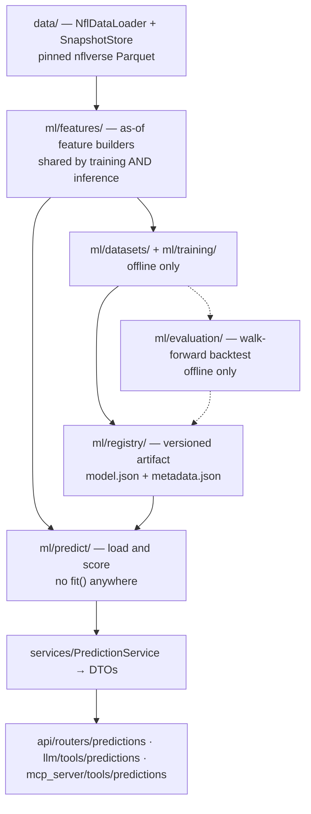

# ML Predictions (Milestone 6)

Two prediction problems, backed by versioned model artifacts. No language model
is involved in producing any number on this page.

- **Game prediction** — probability that the home team wins one game.
- **Fantasy projection** — a player's PPR points in one week, **conditional on
  him playing**.

## Where this sits



`ml/` is a peer of `analytics/` and `retrieval/`: it reads the data layer, and
the service layer composes it. It may not import `services/`, `api/`, `llm/` or
`mcp_server/`, and it contains no LLM. All of that is asserted in
[test_layering.py](../tests/architecture/test_layering.py).

### Four properties the architecture tests enforce

| Property                                                                      | Why it is a test and not a convention                                                                                   |
| ----------------------------------------------------------------------------- | ----------------------------------------------------------------------------------------------------------------------- |
| `sklearn` and `lightgbm` only in `ml/models/`                                 | "Which code can fit a model" stays answerable by naming one directory, the same way `openai` answers to `*/providers/`. |
| Serving never imports `ml.training`, `ml.evaluation`, `ml.datasets`, `ml.cli` | Otherwise one convenience import makes the API process capable of retraining itself on a request.                       |
| `ml/predict/` defines no `fit`                                                | `predict` is the whole serving contract.                                                                                |
| `ml/` imports no `openai`, `httpx`, `mcp` or FastAPI                          | The prediction layer must stay runnable, and testable, with none of them present.                                       |

## Problem 1 — Game prediction

|                     |                                                                                                                                    |
| ------------------- | ---------------------------------------------------------------------------------------------------------------------------------- |
| **Target**          | `home_win ∈ {0,1}`, served as a calibrated `P(home win)`                                                                           |
| **Label**           | `home_score > away_score` from `schedules`. Ties excluded (~0.2% of games); binary classification has no honest encoding for them. |
| **Grain**           | One row per `game_id`, home perspective. Two rows per game would let one game straddle a split.                                    |
| **Horizon**         | One game, pre-kickoff                                                                                                              |
| **Training window** | 2002+ (post-realignment, stable 32-team structure)                                                                                 |
| **Primary metric**  | Brier score                                                                                                                        |
| **Default model**   | `game_win/v1_logistic` — L2 logistic regression, Platt-calibrated                                                                  |

Ties are dropped from the _label_ but still count as half a win in a team's
_form record_. Erasing them from the record would be a different and wrong claim
about the team's season.

## Problem 2 — Fantasy projection

|                     |                                                                                   |
| ------------------- | --------------------------------------------------------------------------------- |
| **Target**          | PPR points for one player in one week                                             |
| **Population**      | QB/RB/WR/TE who took at least one offensive snap                                  |
| **Horizon**         | One week, pre-kickoff                                                             |
| **Training window** | 2013+ (bounded by `snap_counts` coverage from 2012, plus one prior season)        |
| **Primary metric**  | MAE, with within-(season, week, position) Spearman as the product-relevant second |
| **Default model**   | `fantasy_points/v1_lightgbm`                                                      |

### Why the projection is conditional on playing

Rows where a player did not play are **excluded**, not labelled zero. Including
them would change the problem: an inactive player scores zero, so a model
trained on those rows spends most of its capacity learning who is likely to be
inactive, and its MAE then measures availability prediction rather than
production.

Two consequences, stated in the DTO rather than left for a reader to infer:

- the projection means "points **if** he plays", not "points in expectation";
- it must be combined with an availability judgement — which this milestone does
  not model — before it answers a start/sit question on its own.

Excluding the rows has a cost: the population is selected using a fact known
only after kickoff. That is acceptable precisely because the _evaluation_
population is defined the same way, so the reported error is the error on the
rows the projection claims to cover. `FantasyProjection.conditional_on_playing`
is `True` on every response, the tool descriptions say so, and the caveat list
repeats it.

**Only PPR is modelled.** A standard-scoring request raises rather than
returning a PPR number wearing the wrong label.

## Preventing temporal leakage

This is the part of the milestone most worth reading closely.

### 1. One windowing primitive

Every historical feature goes through
[ml/features/windows.py](../src/nfl_platform/ml/features/windows.py), in two
steps that are kept separate on purpose:

1. `trailing_sums` accumulates a team's or player's state **after** each
   completed game. That table is a pure function of finished games and knows
   nothing about what is being predicted.
2. `join_as_of` attaches that state to a target row, matching only history
   **strictly before** the target's own timestamp — implemented by decrementing
   the target's `time_index` by one before an as-of join.

This is not a shifted rolling window, and the difference matters for the case
that breaks naive implementations: **predicting week 18 when week 12 was the
last game played.** A shifted row-window counts the six unplayed games as rows
and silently truncates the lookback. An as-of join cannot, because unplayed
games never enter the history table at all.

### 2. Truncation invariance, as a test

The claim is simple: if deleting every row after week _W_ leaves the week-_W_
features bit-identical, nothing after week _W_ was used to compute them.

Three forms of the check run on every build, for both feature sets:

- delete later **seasons**, rebuild, compare;
- delete later **weeks**, rebuild, compare;
- **rewrite** future results to absurd values, rebuild, compare.

The third is the sharpest: it changes the future rather than removing it, so a
leak cannot hide behind a row count.

### 3. Unknown is not zero

A dataset that does not exist for a period must produce `null`, not `0.0`.
Dividing a snap-share sum by the _game_ count gives `0.0` for a player whose
snap data was never published — which reads as "never on the field". Rate
features are therefore divided by `trailing_observed`, the count of games that
actually carried a value. Seasons before snap counts existed stay honestly
unknown instead of becoming a league of players who never play.

### 4. Fold-local preprocessing

Imputation medians, scaler parameters and the probability calibrator are fitted
inside each training fold. Computing medians over the whole dataset is the
quietest leakage there is: it moves no rows across the split and produces no
error, while letting every fold's imputed values be informed by seasons that
fold is supposed to be blind to.

### 5. Market data is quarantined, not banned

`spread_line` and `total_line` are published before kickoff, so using them is
not leakage — but it is a different information set, embedding news, injuries
and public money.

- **Game model: excluded.** A model given the closing spread mostly learns to
  restate it. `game_win/v1_market_benchmark` fits the line _separately_, so the
  football-only model can be read in context. It is never promotable.
- **Fantasy model: `implied_team_total` is included**, declared with
  `Availability.MARKET_CLOSE`, and `FANTASY_FEATURES.without_market()` produces
  the no-market variant for comparison.

### 6. Banned by construction

No season-end aggregates, standings or playoff seeds. No label-derived columns
(`result`, `total`, final scores). `ff_opportunity`'s `*_diff` columns are
realised-minus-expected _for the current game_ and are only usable lagged.
Injury-report features are excluded entirely in v1 because
`injuries.date_modified` can post-date kickoff — an availability we cannot
prove is an availability we do not use.

## Time-aware validation and the frozen test period

```text
game_win       fit 2002–2023   validate 2020,2021,2022,2023   TEST 2024,2025
fantasy_points fit 2013–2023   validate 2020,2021,2022,2023   TEST 2024,2025
```

Expanding-window walk-forward: fold _k_ trains on everything before validation
season _k_ and scores that season alone.
[`TimeFold`](../src/nfl_platform/ml/datasets/splits.py) raises if its training
seasons reach its evaluation season, so an invalid fold cannot be constructed
even by a buggy harness.

**Random K-fold is wrong here in two independent ways.** It leaks forward —
rule changes, the 2020 crowdless season, the 2021 move to 17 games and a decade
of rising pass rates all mean a 2024 row tells you about the 2024 scoring
environment. And it mismatches the use: the model is always asked "fit on
everything through last week, now predict next week", which walk-forward _is_.

### The test period is derived, not hard-coded

`complete_seasons()` reads the snapshot and calls a season complete when it
contains a completed championship game, falling back to a regular-season volume
of **distinct games**. The latest two complete seasons become the frozen test
block. Re-running against a newer snapshot moves the window forward rather than
testing on seasons that have since become training-era.

The fallback counts distinct `game_id`s rather than rows for a specific reason:
a player-week frame reaches 200 rows in the first weekend of a season, and
counting rows would let an in-progress season be chosen as the test period.
That bug existed during development and is now pinned by a test.

**The test block is scored once, at the very end.** `test_evaluations` in each
artifact's metadata records how many times; anything other than `1` means it has
informed a decision and is no longer a held-out estimate.

## The promotion rule

Written before any model was trained:

> A candidate becomes the default only if it beats the simpler model on the
> primary metric by **more than the standard deviation of the per-fold
> differences**.

Comparing pooled validation scores and shipping the lower number is how projects
end up with a boosted model that is worse in production than the regression it
replaced. A 0.003 Brier difference across four seasons is indistinguishable from
which seasons happened to land in the window.

Every baseline is a real, loadable, servable artifact — a fallback that cannot
be served is not a fallback the rule can choose.

## Results

Snapshot `training`, nflverse seasons 2002–2026, pinned
`data/snapshots/training/`. Regenerate with `python scripts/report_models.py`.

### Game prediction — 6,453 usable games, 569 in the test period

| Model                       | Role      | Valid. Brier | Valid. acc | Test Brier | Test acc  | Test AUC | Test ECE | Test BSS vs baseline |
| --------------------------- | --------- | ------------ | ---------- | ---------- | --------- | -------- | -------- | -------------------- |
| `v1_baseline` (home-field)  | baseline  | 0.2496       | 0.538      | 0.2489     | 0.541     | 0.500    | 0.024    | 0.000                |
| **`v1_logistic`** ← default | candidate | **0.2265**   | 0.621      | **0.2221** | **0.634** | 0.686    | 0.038    | **0.108**            |
| `v1_lightgbm`               | candidate | 0.2316       | 0.614      | 0.2244     | 0.636     | 0.682    | 0.039    | 0.098                |
| `v1_market_benchmark`       | benchmark | —            | —          | 0.2060     | 0.682     | 0.738    | 0.034    | —                    |

**Logistic regression is the default.** LightGBM changed validation Brier by
−0.0049 across four folds against a fold-to-fold variation of 0.0070 — not
distinguishable from noise, so the simpler model stays. Its training Brier of
0.179 against 0.232 on validation shows what the rule caught: the booster is
memorising training seasons. At ~5,800 rows and 22 differenced features, this is
the regime where regularised logistic regression is simply the right answer.

The market benchmark is better than both, and that is the honest context: a
football-only model recovering a Brier of 0.222 against the closing line's 0.206
has captured most, not all, of the available signal. The line is not an input to
either model.

### Fantasy projection — 65,966 player-weeks, 11,293 in the test period

| Model                       | Role      | Valid. MAE | Valid. week-ρ | Test MAE   | Test RMSE | Test R² | Test week-ρ | Test MAE vs baseline |
| --------------------------- | --------- | ---------- | ------------- | ---------- | --------- | ------- | ----------- | -------------------- |
| `v1_rolling_average`        | baseline  | 5.1558     | 0.530         | 4.9569     | 6.8552    | 0.278   | 0.563       | —                    |
| `v1_ridge`                  | candidate | 4.8144     | 0.588         | 4.6614     | 6.2548    | 0.399   | 0.614       | 6.0%                 |
| **`v1_lightgbm`** ← default | candidate | **4.7711** | 0.594         | **4.6163** | 6.2035    | 0.409   | **0.622**   | **6.9%**             |

**LightGBM is the default.** It improved validation MAE by 0.0436 against a
fold-to-fold variation of 0.0203 — a small but real margin, which is what the
rule is for. Ridge clears the rolling-average baseline by far more (0.342), so
most of the value is in the features, not the booster.

### Reading these numbers honestly

Weekly fantasy scoring is intrinsically high-variance. A test R² of 0.41 and a
7% MAE improvement over a three-game average is a _real_ result, not a
disappointing one. Likewise 63% accuracy on NFL games: the home-field baseline
is already 54–57%, and public models land in the low-to-mid 60s without market
data.

A result materially better than this would be treated as a leakage alarm, not a
success. The first response would be to re-run the truncation-invariance tests.

## Calibration

The game model's probabilities are **Platt-scaled** (`platt_sigmoid`), fitted on
out-of-fold validation predictions — never on training predictions, which
reliably makes real-world calibration worse, and never on the test block, which
would spend the frozen data on a modelling decision.

Platt rather than isotonic because a validation fold here is roughly a thousand
games; isotonic is non-parametric and would carve that into a step function
fitting the fold's noise. Below `MIN_CALIBRATION_ROWS` (200) calibration is
skipped and `calibration_method` is recorded as `null` rather than implying a
calibration that did not happen.

Calibration quality is **measured, not assumed**: expected calibration error and
a 10-bin reliability table are recorded in every artifact's metadata.

### Uncertainty

- **Classification: the probability is the confidence.** There is no separate
  score.
- **Regression: no interval is claimed.** `floor_points` and `ceiling_points`
  are `null` in v1. A fabricated Gaussian interval on right-skewed, non-negative
  fantasy points would be a lie. Instead `typical_error` carries the model's
  validation MAE as a scale reference, explicitly labelled as a model-level
  figure rather than an interval for that player. Quantile models are future
  work (see below).

## Model artifacts

```text
data/models/
    manifest.json                     # problem -> default version
    game_win/
        training_report.json
        v1_baseline/        model.json  metadata.json
        v1_logistic/        model.json  metadata.json
        v1_lightgbm/        model.json  metadata.json
        v1_market_benchmark/model.json  metadata.json
    fantasy_points/
        v1_rolling_average/ ...
        v1_ridge/ ...
        v1_lightgbm/ ...
```

### No pickle, anywhere

Linear models and baselines serialise as JSON coefficients plus preprocessing
parameters; LightGBM embeds its own plain-text booster dump. `joblib.load` on a
path is arbitrary code execution, and a model directory is exactly the kind of
thing that gets copied between machines, committed by accident, or restored from
an unaudited backup. A format that can only ever produce numbers removes the
question instead of mitigating it. It is also diffable, portable across library
patch releases, and small enough that fixture artifacts are trivial.

### Integrity and compatibility, checked on every load

| Check                                                        | Failure                                                                                                                              |
| ------------------------------------------------------------ | ------------------------------------------------------------------------------------------------------------------------------------ |
| `artifact_sha256` over `model.json`                          | `ModelArtifactInvalidError` — a tampered artifact that still parses would keep producing confident numbers from the wrong parameters |
| Artifact schema version                                      | `ModelArtifactInvalidError`                                                                                                          |
| Model features vs metadata feature list                      | `ModelArtifactInvalidError`                                                                                                          |
| Built features vs artifact feature list, **including order** | `FeatureSchemaMismatchError` — estimators score positional arrays, so a reordering is silent corruption                              |

Resolution is by `(problem, version)` and never by a caller-supplied path;
version names are validated against `^[A-Za-z0-9][A-Za-z0-9_.-]{0,63}$`, so no
input can traverse out of the configured directory.

Artifacts are **not committed** — they are derived output, rebuildable in under
a minute, and `data/*` is already gitignored. The same stance as the RAG index.

### What metadata records

`model_id`, `problem`, `version`, `algorithm`, `role`, `trained_at`,
`feature_schema_version`, the ordered `feature_names`, `train_seasons`,
`validation_seasons`, `test_seasons`, `fit_seasons`, `primary_metric`,
`random_seed`, `data_snapshot`, `training_rows`, `feature_matrix_hash`,
`calibration_method`, `hyperparameters`, `train_metrics`, `validation_metrics`,
per-fold `validation_folds`, `test_metrics`, `baseline_metrics`,
`benchmark_metrics`, the `promotion` decision with its evidence,
`split_rationale`, `test_evaluations`, `library_versions`, the `command` that
produced it, and `notes`.

A subset of this travels to every caller as `ModelInfo` on every prediction DTO,
and through `GET /predictions/models` and the `nfl://models` resource.

## Reproducibility

| Mechanism              | Detail                                                                                                                        |
| ---------------------- | ----------------------------------------------------------------------------------------------------------------------------- |
| Pinned input           | Training reads a named `SnapshotStore` snapshot, not live nflverse, which revises historical rows                             |
| Single seed            | `NFL_ML_RANDOM_SEED` threaded through every estimator; no bare `np.random`                                                    |
| LightGBM determinism   | `deterministic=True`, `force_row_wise=True`, `num_threads=1` — without these, histogram construction varies with thread count |
| Deterministic ordering | Frames sorted by `(time_index, key)` before every fit                                                                         |
| Content hash           | `feature_matrix_hash` proves a later run trained on the same rows                                                             |
| Exact versions         | `library_versions` records resolved python/numpy/polars/sklearn/lightgbm                                                      |

Two training runs on the same snapshot produce the same promotion decision, the
same metrics and the same feature hash — pinned by
[test_training_smoke.py](../tests/ml/test_training_smoke.py).

## Prediction service and DTOs

```python
container.predictions.model_status()               -> ModelRegistryStatus
container.predictions.predict_game(...)            -> GamePrediction
container.predictions.predict_slate(season, week)  -> GamePredictionSlate
container.predictions.project_fantasy_points(...)  -> FantasyProjection
container.predictions.compare_projections(...)     -> FantasyProjectionComparison
```

Every prediction DTO carries three blocks, none optional:

- **`model_info`** — which artifact, trained on which seasons, scoring what.
  Without it, "61%" is indistinguishable from a guess.
- **`basis`** — how much history the features were actually built from. A week-1
  and a week-12 prediction are not the same kind of claim even at the same
  probability.
- **`caveats`** — in the payload rather than left to the presentation layer,
  because the two consumers most likely to drop them (a language model writing
  prose, and a JSON client) are the ones that most need them.

`top_factors` are SHAP values for tree models and standardised
coefficient×value products for linear ones — derived in the prediction layer,
never narrated by an LLM. An empty list honestly means "this model family does
not attribute its output".

## Keeping predictions distinguishable from statistics

Seven layers, mostly mechanical:

1. **Separate DTO types.** No analytics DTO has a `model_info` field; every
   prediction DTO does.
2. **Separate service** — `container.predictions`.
3. **`SourceKind.MODEL`**, alongside `STRUCTURED`, `WEB`, `KNOWLEDGE_BASE`.
   `GROUNDING_KINDS = {STRUCTURED, MODEL}` lets a model number ground an answer
   (this system computed it); `RETRIEVAL_KINDS = {WEB, KNOWLEDGE_BASE}` does not.
4. **Separate naming** — `predict_*` / `project_*` versus `get_*` / `compare_*`.
5. **Citations credit the artifact**, not the tool: `collect_sources` emits
   `{"kind": "model", "label": "game_win/v1_logistic"}`.
6. **Prompt rules** — the analyst system prompt and the MCP server instructions
   both state that win probabilities and projections come only from the
   prediction tools, and that the two kinds of claim must not be mixed.
7. **URL namespace** — `/api/v1/predictions/...` is the only part of the HTTP
   surface where a number refers to an unplayed game.

### Authority order

| Source                  | Authoritative for                               | Not for                   |
| ----------------------- | ----------------------------------------------- | ------------------------- |
| Deterministic analytics | What happened in played games                   | Anything about the future |
| Prediction models       | Estimates about unplayed games                  | Measured statistics       |
| Web retrieval           | Current external facts (injuries, transactions) | Statistics; model inputs  |
| Local RAG               | Stable definitions, rules, conventions          | Anything current          |
| LLM                     | Routing, explanation, synthesis                 | **Any number at all**     |

## Interfaces

### REST

| Route                                           | Returns                                                    |
| ----------------------------------------------- | ---------------------------------------------------------- |
| `GET /api/v1/predictions/models`                | `ModelRegistryStatus` — 200 even when nothing is installed |
| `GET /api/v1/predictions/game`                  | `GamePrediction`                                           |
| `GET /api/v1/predictions/slate/{season}/{week}` | `GamePredictionSlate`                                      |
| `GET /api/v1/predictions/fantasy/{player_id}`   | `FantasyProjection`                                        |
| `POST /api/v1/predictions/fantasy/compare`      | `FantasyProjectionComparison`                              |

### LLM tools and MCP

The same four capabilities appear in both adapters with the same names and the
same argument definitions (shared via
[schemas/fields.py](../src/nfl_platform/schemas/fields.py)): `predict_game`,
`predict_slate`, `project_fantasy_points`, `compare_fantasy_projections`.
Parity is pinned by [test_parity.py](../tests/mcp_server/test_parity.py).

MCP additionally exposes the `nfl://models` resource and a `predict_game`
prompt that routes the number to the model and the explanation to the analytics
tools.

### Error behaviour

Absence is success; unavailability is an error. An empty slate is a fact; "no
model installed" is a capability state and is never evidence about a game.

| Exception                    | HTTP | Tool code                 | Recovery given to the model                           |
| ---------------------------- | ---- | ------------------------- | ----------------------------------------------------- |
| `ModelNotAvailableError`     | 503  | `model_not_available`     | Do not estimate; say no model prediction is available |
| `ModelVersionNotFoundError`  | 404  | `model_version_not_found` | Omit the version to use the default                   |
| `ModelArtifactInvalidError`  | 500  | `model_artifact_invalid`  | Do not retry; report unavailable                      |
| `FeatureSchemaMismatchError` | 500  | `feature_schema_mismatch` | Retrain; the number would come from the wrong inputs  |
| `InsufficientHistoryError`   | 422  | `insufficient_history`    | Ask about a later week; do not guess                  |

MCP renders the first four with the "this is the state of the capability, not a
finding about the world" notice.

## Configuration

No API keys. No new infrastructure. No database.

| Setting                     | Default       | Purpose                             |
| --------------------------- | ------------- | ----------------------------------- |
| `NFL_MODEL_DIR`             | `data/models` | Artifact directory                  |
| `NFL_ML_ENABLE_PREDICTIONS` | `true`        | Kill-switch for the whole surface   |
| `NFL_GAME_MODEL_VERSION`    | unset         | Pin a game artifact version         |
| `NFL_FANTASY_MODEL_VERSION` | unset         | Pin a fantasy artifact version      |
| `NFL_ML_RANDOM_SEED`        | `1799`        | Seeds every estimator               |
| `NFL_ML_MIN_HISTORY_GAMES`  | `3`           | Below this, raise rather than guess |
| `NFL_ML_TRAINING_SNAPSHOT`  | `training`    | Snapshot training reads             |

## Commands

```bash
# Pin the data once (downloads ~300-600 MB into data/cache and data/snapshots)
python scripts/train_models.py snapshot --from-season 2002

# Train, evaluate, version and promote
python scripts/train_models.py train
python scripts/train_models.py train --problem game
python scripts/train_models.py train --dry-run        # evaluate, write nothing

# Inspect recorded results without retraining
python scripts/report_models.py
python scripts/report_models.py --features            # the feature dictionary

# Sanity-check a freshly trained model end to end
python scripts/check_predictions.py 2025 1 KC BUF

# Tests (offline, no downloads, no training on real data)
pytest                                    # full default suite
pytest tests/unit/ml tests/ml             # the ML layer
pytest -m training                        # opt-in heavy training tests
```

CI never downloads nflverse and never trains on real data. The ML tests run
against a generated league in [tests/synthetic.py](../tests/synthetic.py), which
carries real signal (latent team strengths, home advantage) so that "the model
beats the baseline" and the leakage checks are meaningful rather than vacuous.

## Dependencies, storage, cost

|                    |                                                                                                                          |
| ------------------ | ------------------------------------------------------------------------------------------------------------------------ |
| **Added**          | `scikit-learn>=1.5`, `lightgbm>=4.5` (plus numpy/scipy transitively)                                                     |
| **Rejected**       | `xgboost` (redundant with LightGBM), `shap` (LightGBM's `pred_contrib` covers it), `torch`/`tensorflow`, `mlflow`, `dvc` |
| **Artifacts**      | < 3 MB total, text, gitignored                                                                                           |
| **Training cache** | ~300–600 MB local, gitignored. Play-by-play deliberately excluded — several GB for an unproven delta                     |
| **Training time**  | Both problems, full walk-forward: well under a minute on a laptop CPU                                                    |
| **Inference**      | Feature build dominates; warm predictions are sub-100 ms                                                                 |
| **API cost**       | Zero. No LLM, embedding or web call anywhere in training, evaluation or inference                                        |
| **GPU**            | None. LightGBM is CPU-only here                                                                                          |
| **CI impact**      | ~80 MB of extra wheels and a few seconds of install                                                                      |

## Feature dictionary

Generated from the `FeatureSet` objects with
`python scripts/report_models.py --features`, so the documented availability of
each input cannot drift from the code that builds it. A test asserts every
column in a built matrix has a registered `FeatureSpec`, so an undocumented
feature cannot appear silently.

`end_of_prior_game` means the value is aggregated only from games that finished
before the one being predicted. `at_scheduling` means it is fixed when the
schedule is published. `market_close` means it is a published betting line —
known before kickoff, but a different information set.

### Game prediction (`game-v1`, 22 features)

| Feature                        | Source dataset | Available         | Lookback               | Meaning                                                                                               |
| ------------------------------ | -------------- | ----------------- | ---------------------- | ----------------------------------------------------------------------------------------------------- |
| `off_epa_per_play_diff`        | `team_stats`   | end_of_prior_game | last 8 completed games | Home minus away offensive expected points added per play.                                             |
| `def_epa_per_play_diff`        | `team_stats`   | end_of_prior_game | last 8 completed games | Home minus away expected points added allowed per defensive play. Negative favours the home team.     |
| `points_for_per_game_diff`     | `schedules`    | end_of_prior_game | last 8 completed games | Home minus away points scored per game.                                                               |
| `points_against_per_game_diff` | `schedules`    | end_of_prior_game | last 8 completed games | Home minus away points allowed per game. Negative favours the home team.                              |
| `off_yards_per_play_diff`      | `team_stats`   | end_of_prior_game | last 8 completed games | Home minus away net yards per offensive play, sack yardage deducted.                                  |
| `def_yards_per_play_diff`      | `team_stats`   | end_of_prior_game | last 8 completed games | Home minus away net yards allowed per defensive play.                                                 |
| `off_first_down_rate_diff`     | `team_stats`   | end_of_prior_game | last 8 completed games | Home minus away offensive first downs per play. A success-rate proxy that needs no play-by-play data. |
| `def_first_down_rate_diff`     | `team_stats`   | end_of_prior_game | last 8 completed games | Home minus away first downs allowed per defensive play.                                               |
| `turnovers_per_game_diff`      | `team_stats`   | end_of_prior_game | last 8 completed games | Home minus away giveaways per game: interceptions plus lost fumbles.                                  |
| `takeaways_per_game_diff`      | `team_stats`   | end_of_prior_game | last 8 completed games | Home minus away takeaways forced per game.                                                            |
| `sack_rate_allowed_diff`       | `team_stats`   | end_of_prior_game | last 8 completed games | Home minus away sacks allowed per dropback.                                                           |
| `sack_rate_forced_diff`        | `team_stats`   | end_of_prior_game | last 8 completed games | Home minus away sacks forced per opponent dropback.                                                   |
| `penalty_yards_per_game_diff`  | `team_stats`   | end_of_prior_game | last 8 completed games | Home minus away penalty yards conceded per game.                                                      |
| `recent_win_rate_diff`         | `schedules`    | end_of_prior_game | last 5 completed games | Home minus away win rate. Ties count as half a win.                                                   |
| `recent_point_margin_diff`     | `schedules`    | end_of_prior_game | last 5 completed games | Home minus away average scoring margin.                                                               |
| `rest_days_diff`               | `schedules`    | at_scheduling     | point-in-time          | Home minus away days since each team's previous game.                                                 |
| `div_game`                     | `schedules`    | at_scheduling     | point-in-time          | 1 when the teams share a division.                                                                    |
| `is_dome`                      | `schedules`    | at_scheduling     | point-in-time          | 1 when the roof is closed, fixed or retractable.                                                      |
| `is_turf`                      | `schedules`    | at_scheduling     | point-in-time          | 1 when the playing surface is artificial.                                                             |
| `neutral_site`                 | `schedules`    | at_scheduling     | point-in-time          | 1 when neither team is really at home, so the home-field term should not apply.                       |
| `week`                         | `schedules`    | at_scheduling     | point-in-time          | Week number. Lets the model discount early-season form built on few games.                            |
| `history_games_min`            | `schedules`    | end_of_prior_game | capped at 8            | Completed games behind the less-established of the two teams.                                         |

### Fantasy projection (`fantasy-v1`, 32 features)

| Feature                            | Source dataset   | Available         | Lookback              | Meaning                                                                                                                                                                |
| ---------------------------------- | ---------------- | ----------------- | --------------------- | ---------------------------------------------------------------------------------------------------------------------------------------------------------------------- |
| `ppr_per_game_recent`              | `player_stats`   | end_of_prior_game | last 3 games played   | Mean PPR points over recent games played.                                                                                                                              |
| `ppr_per_game_long`                | `player_stats`   | end_of_prior_game | last 8 games played   | Mean PPR points over the longer window.                                                                                                                                |
| `ppr_volatility`                   | `player_stats`   | end_of_prior_game | last 8 games played   | Standard deviation of PPR points; separates a steady floor from a boom-bust role.                                                                                      |
| `exp_ppr_per_game_recent`          | `ff_opportunity` | end_of_prior_game | last 3 games played   | Mean expected PPR points from opportunity data over recent games.                                                                                                      |
| `exp_ppr_per_game_long`            | `ff_opportunity` | end_of_prior_game | last 8 games played   | Mean expected PPR points over the longer window.                                                                                                                       |
| `ppr_minus_expected_long`          | `ff_opportunity` | end_of_prior_game | last 8 games played   | Realised minus expected points per game. Positive means recent scoring ran ahead of opportunity, which historically regresses.                                         |
| `snap_share_recent`                | `snap_counts`    | end_of_prior_game | last 3 games played   | Mean share of offensive snaps over recent games.                                                                                                                       |
| `snap_share_long`                  | `snap_counts`    | end_of_prior_game | last 8 games played   | Mean share of offensive snaps over the longer window.                                                                                                                  |
| `target_share_recent`              | `player_stats`   | end_of_prior_game | last 3 games played   | Mean share of team targets over recent games.                                                                                                                          |
| `air_yards_share_recent`           | `player_stats`   | end_of_prior_game | last 3 games played   | Mean share of team air yards over recent games.                                                                                                                        |
| `wopr_recent`                      | `player_stats`   | end_of_prior_game | last 3 games played   | Weighted opportunity rating: target share and air-yards share combined.                                                                                                |
| `targets_per_game_recent`          | `player_stats`   | end_of_prior_game | last 3 games played   | Mean targets over recent games.                                                                                                                                        |
| `carries_per_game_recent`          | `player_stats`   | end_of_prior_game | last 3 games played   | Mean rushing attempts over recent games.                                                                                                                               |
| `attempts_per_game_recent`         | `player_stats`   | end_of_prior_game | last 3 games played   | Mean pass attempts over recent games. Separates starting quarterbacks.                                                                                                 |
| `receptions_per_game_recent`       | `player_stats`   | end_of_prior_game | last 3 games played   | Mean receptions over recent games.                                                                                                                                     |
| `history_games`                    | `player_stats`   | end_of_prior_game | capped at 8           | Games played before this one, capped at the long window.                                                                                                               |
| `weeks_since_last_game`            | `player_stats`   | end_of_prior_game | point-in-time         | Weeks since the player last took a snap. Flags a bye, a return from injury or a long absence without needing an injury report.                                         |
| `opponent_ppr_allowed_to_position` | `player_stats`   | end_of_prior_game | last 8 opponent games | Mean PPR points the opponent has allowed per game to this position.                                                                                                    |
| `opponent_def_epa_per_play`        | `team_stats`     | end_of_prior_game | last 8 opponent games | Expected points added the opponent allows per defensive play.                                                                                                          |
| `opponent_points_allowed_per_game` | `schedules`      | end_of_prior_game | last 8 opponent games | Points the opponent allows per game.                                                                                                                                   |
| `team_plays_per_game`              | `team_stats`     | end_of_prior_game | last 8 team games     | The player's own team's offensive plays per game; a pace and volume proxy.                                                                                             |
| `is_home`                          | `schedules`      | at_scheduling     | point-in-time         | 1 when the player's team is at home.                                                                                                                                   |
| `rest_days`                        | `schedules`      | at_scheduling     | point-in-time         | Days since the team's previous game.                                                                                                                                   |
| `is_dome`                          | `schedules`      | at_scheduling     | point-in-time         | 1 when the roof is closed.                                                                                                                                             |
| `is_turf`                          | `schedules`      | at_scheduling     | point-in-time         | 1 when the surface is artificial.                                                                                                                                      |
| `div_game`                         | `schedules`      | at_scheduling     | point-in-time         | 1 for a divisional game.                                                                                                                                               |
| `week`                             | `schedules`      | at_scheduling     | point-in-time         | Week number.                                                                                                                                                           |
| `is_qb`                            | `player_stats`   | at_scheduling     | point-in-time         | Position indicator.                                                                                                                                                    |
| `is_rb`                            | `player_stats`   | at_scheduling     | point-in-time         | Position indicator.                                                                                                                                                    |
| `is_wr`                            | `player_stats`   | at_scheduling     | point-in-time         | Position indicator.                                                                                                                                                    |
| `is_te`                            | `player_stats`   | at_scheduling     | point-in-time         | Position indicator.                                                                                                                                                    |
| `implied_team_total`               | `schedules`      | market_close      | point-in-time         | Points the closing line implies for the player's team: half the total, adjusted by half the spread. A scoring-environment estimate, not a statement about this player. |

## Known limitations

- **No availability model.** Fantasy projections are conditional on playing and
  carry no estimate of the chance a player is inactive. This is the single
  biggest gap between the projection and a complete start/sit answer.
- **PPR only.** Standard scoring is refused rather than approximated.
- **No play-by-play features.** Success rate, early-down EPA, pass rate over
  expected, red-zone usage and route counts all need PBP, which is several GB.
  Deliberately excluded from v1.
- **No injury features.** `injuries.date_modified` can post-date kickoff, so
  availability at prediction time cannot be proven.
- **No quantile intervals.** `floor_points` / `ceiling_points` are `null`.
- **The game model is market-free by design**, so it should be expected to trail
  the closing line, and it does (test Brier 0.222 vs 0.206).
- **Hypothetical matchups** assume an outdoor grass stadium with equal rest,
  recorded as a caveat.
- **Early-season predictions are weaker.** Week 1 leans on the previous season's
  form, which does not account for roster turnover.

## Future work

Not implemented, and listed so the boundary between done and intended is clear.

- **Availability model** — a `played_probability` classifier, combined with the
  conditional projection to give an unconditional expectation. The highest-value
  next step.
- **Quantile fantasy models** — LightGBM q10/q90 for honest floor/ceiling,
  validated by pinball loss and empirical coverage.
- **Play-by-play features**, if and only if v1 plateaus and the storage cost is
  accepted.
- **Margin-of-victory regression** mapped to a win probability, which is
  classically slightly better-calibrated than direct classification.
- **PyTorch.** Deliberately _not_ implemented. At ~5,800 game rows and ~54,000
  tabular player-weeks, gradient-boosted trees and regularised linear models are
  the right tools, and the evidence above is that even LightGBM could not beat
  logistic regression on the game problem. A neural network would be a resume
  keyword, not a modelling decision. A specific question that could justify
  revisiting it: learned player and team embeddings for the fantasy model, where
  entity identity carries signal that hand-built features may miss. That would
  need to beat `v1_lightgbm` under the same promotion rule to ship.
